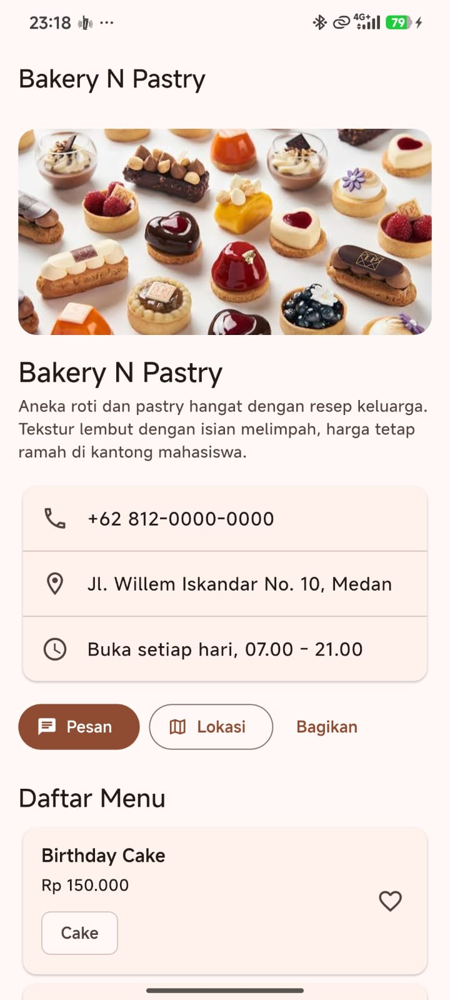
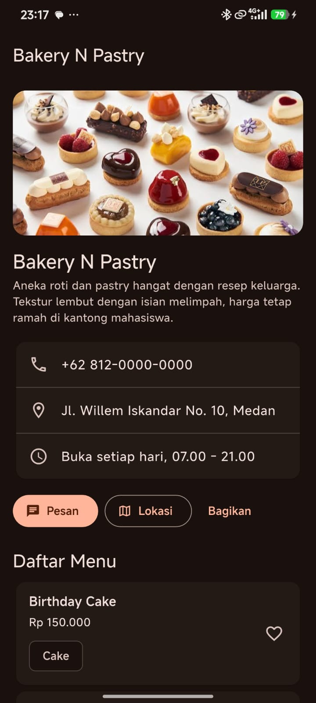

# Tugas Rutin 5 – Menu UMKM Kuliner Medan

## Identitas
- Nama: Adinda Soleha
- NIM 4242550001
- Kelas: PSIK 24D
- Mata Kuliah: Pemrograman Mobile 

## Tangkapan Layar
| Mode Terang | Mode Gelap |
|---|---|
|  |  |

## Diagram Widget Tree
`[S]` = StatelessWidget, `[F]` = StatefulWidget

```
MenuUmkmApp [S]
└── MaterialApp
    └── HalamanMenu [S]
        └── Scaffold
            ├── AppBar
            └── SingleChildScrollView
                └── Column
                    ├── KepalaUsaha [S]  (Image, Text, Text)
                    ├── BagianKontak [S]
                    │   ├── Card > Column > ListTile x3
                    │   └── Wrap > FilledButton, OutlinedButton, TextButton
                    ├── Text('Daftar Menu')
                    └── KartuMenu [S] x5
                        └── Card > Row
                            ├── Column > Text, Text, Chip
                            └── TombolFavorit [F]
                                └── IconButton > Icon
```

## Penjelasan Arsitektur

Flutter membangun antarmuka dengan tiga pohon yang saling berpasangan. Widget tree adalah susunan widget yang saya tulis di dalam `build()`. Widget bersifat immutable dan hanya berisi konfigurasi tentang apa yang ingin ditampilkan, sehingga dibuat ulang setiap kali `build()` dipanggil. Element tree adalah jembatan yang bertahan lama: setiap widget punya satu element pada posisinya, yang menyimpan objek `State`, menjadi `BuildContext`, dan mencocokkan widget baru dengan yang lama berdasarkan tipe dan key. Render tree berisi objek seperti `RenderFlex` dan `RenderParagraph` yang menghitung layout (ukuran dan posisi) lalu menggambarnya ke layar. Karena element dan render object lama dipakai ulang jika cocok, hanya properti yang berubah yang diperbarui, sehingga aplikasi tetap cepat.

Pada aplikasi ini, `MenuUmkmApp`, `HalamanMenu`, `KepalaUsaha`, `BagianKontak`, dan `KartuMenu` saya buat sebagai StatelessWidget karena tampilannya hanya bergantung pada parameter dari luar dan tidak punya data yang berubah. `TombolFavorit` saya buat sebagai StatefulWidget karena menyimpan `_favorit` yang berubah akibat interaksi pengguna. Bagian Stateful sengaja dibuat sekecil mungkin, yaitu hanya satu ikon, sehingga `setState` hanya membangun ulang tombol itu, bukan seluruh halaman. Selain itu, konstruktor `const` dipakai di mana pun memungkinkan agar Flutter dapat melewati pembangunan ulang widget yang tidak berubah.

## Pernyataan Penggunaan AI

Saya menggunakan Claude untuk membantu menyusun kerangka kode awal aplikasi, membagi pengerjaan menjadi tiga commit, memperbaiki error pada widget test, dan menyusun draf penjelasan arsitektur. Seluruh kode dan penjelasan telah saya pelajari, uji, dan sesuaikan sendiri, termasuk mengganti data usaha menjadi Bakery N Pastry dan memakai aset gambar yang ditambahkan sendiri.

## Cara Menjalankan
```
flutter pub get
flutter run
flutter test
```